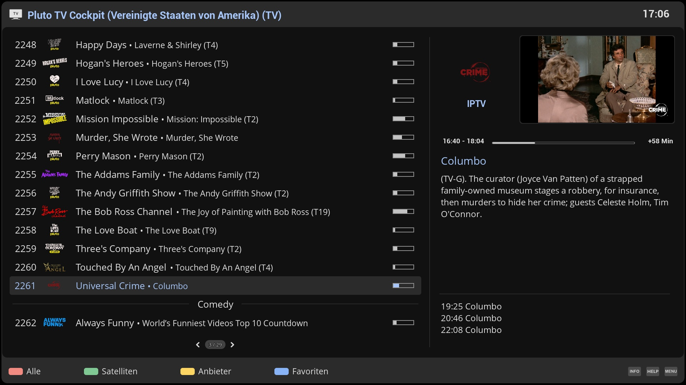
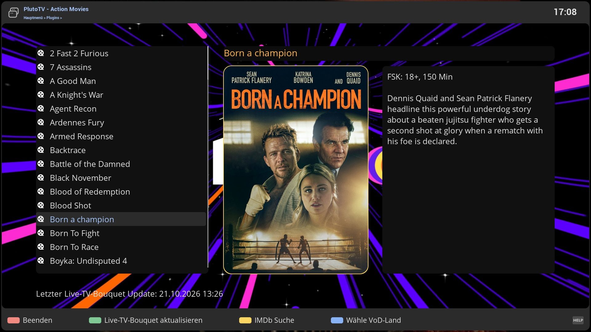
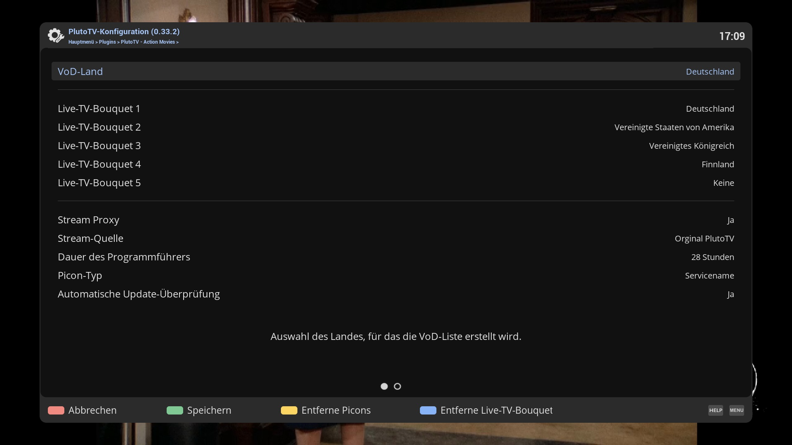

# PlutoTVCockpit (PTV)
Open-Enigma2 plugin for Live-TV and VoD streams

## Live-TV

## Video-On-Demand

## Configuration

## Features
- Playback of Pluto TV live channels and VoD content by country
- Generation of E2 bouquets including EPG
- Optional stream proxy (setting *Stream proxy*, on by default): the channels are played and recorded through StreamProxyCockpit (the bouquet holds a lazy `pluto://<channel id>` address per channel). Off, the bouquet holds the addresses of the stream source itself. The source (setting *Stream source*: Stitcher or JMP2; Stitcher by default) applies with and without the proxy. The bouquet of each setting is kept (`.tv.proxy`, `.tv.noproxy`) and `.tv` always holds the one of the current setting: changing it switches between them, a bouquet that does not exist yet or is older than the update interval (5 hours) is generated
- Download of channel picons
- Record channels - instant and timer recording

## Disclaimer
The project author is not responsible for how this software is used by others. It is not intended to be used for accessing or distributing copyrighted materials without authorization.
Users are solely responsible for determining the legality of their actions.

This repository has no control over the streams, links, or the legality of the content provided by the different hosts (including all mirror sites). It is the end user's responsibility to ensure the legal use of these streams, and we strongly recommend verifying that the content complies with all applicable laws, including copyright laws and regulations of your country's jurisdiction before use.

## Limitations
- Tested on OpenViX and OpenATV with DM900.

## Installation
- https://OpenCockpit.github.io/PlutoTVCockpit

## Wiki
- https://github.com/OpenCockpit/PlutoTVCockpit/wiki
